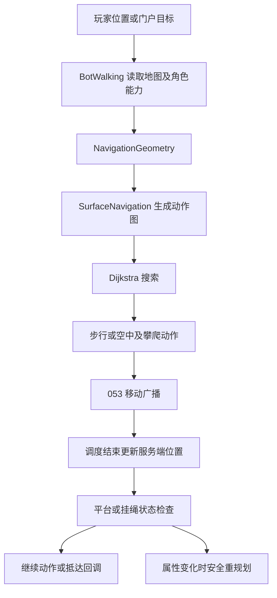

# GMS053 持久机器人 1.2 导航实现与问题复盘

更新日期为 2026-11-25。

本文对应需求中的子里程碑 1.2“导航与跨图”。本轮结束时用户消息中的“2.1”按本阶段理解，仓库继续沿用 1.2 编号。实现入口、验收范围和后续兼容项以本文为当前快照；需求说明中此前逐轮追加的进度用于追溯演进。

## 本轮交付与收尾决定

本轮导航基线验收收尾。用户已逐轮反馈走、跳、走出平台下落、上下梯绳、跳抓、挂绳与跳离、移速 +40/跳跃 +20、跨图、脚本门和回城卷可用，并在最后一轮反馈新增能力可以。053 的方向键下加跳跃功能未接入；下降路线使用平台边缘走出、松绳下落及跳离。

特殊碰顶、跨层碰撞和地图机制按用户决定，在遇到具体场景时继续处理。当前可以进入后续开发，1.2 的通用导航代码及测试命令保留为回归基础。

此外仍有兼容和性能边界，见本文末尾。它们不能被“地图结构扫描通过”替代成全地图游戏内验收通过。

## 调用链与模块职责

聊天 GM 命令经过 CommandsExecutor 权限检查进入 Server，再由 BotLifecycle 定位当前托管会话，PersistentBotAdapter 检查世界和频道并调用 BotWalking。地图中的 Character、背包、技能效果和保存继续使用现有服务器对象。

BotLifecycle 属于 gms-ai，持有一个会话及动作接口。NavigationGeometry、BallisticReachability 和 SurfaceNavigation 也属于 gms-ai，负责几何、轨迹和路线。gms-handler 持有 Character、WZ 地图对象、调度器、脚本、库存和 053 协议，以适配层连接到规划器。

同图主链如下。

主要源码如下。

- [BotLifecycle](../../../gms-server/gms-ai/src/main/java/org/gms/ai/BotLifecycle.java) 管理会话和动作转发。
- [NavigationGeometry](../../../gms-server/gms-ai/src/main/java/org/gms/ai/NavigationGeometry.java) 计算斜坡高度、脚下平台、下降交点和墙交点。
- [BallisticReachability](../../../gms-server/gms-ai/src/main/java/org/gms/ai/BallisticReachability.java) 生成带时间的跳落轨迹。
- [SurfaceNavigation](../../../gms-server/gms-ai/src/main/java/org/gms/ai/SurfaceNavigation.java) 建图、组合动作并搜索路线。
- [BotWalking](../../../gms-server/gms-handler/src/main/java/org/gms/bot/BotWalking.java) 读取角色状态、发包、调度、重规划、跨图和回城。
- [BotWalkNavigation](../../../gms-server/gms-handler/src/main/java/org/gms/bot/BotWalkNavigation.java) 与 [WalkNavigation](../../../gms-server/gms-ai/src/main/java/org/gms/ai/WalkNavigation.java) 提供执行层已有的纯步行路线。
- [MapFactory](../../../gms-server/gms-handler/src/main/java/org/gms/server/maps/MapFactory.java) 加载梯绳并提供跨图门户元数据。
- [PacketCreator](../../../gms-server/gms-handler/src/main/java/org/gms/util/PacketCreator.java) 编码 053 的生成包与移动包。

## 地图与能力输入

地图几何读取 foothold、ladderRope 和 portal。foothold 的端点、prev/next 连接用于平台和实墙判断；ladderRope 的 ID、X、y1/y2、l、uf 用于攀爬；portal 的名称、类型、目标地图、目标门户和脚本决定过图入口。不同地图的平台和门户 ID 都由数据提供。

Foothold.isNavigationWall 从竖段下端的连接追踪到地面，筛掉悬空侧边。步行图对同一条连续地面及相同端点建立连接。空中路径继续检查筛选后的墙段。

本服 Physics.img 中 walkSpeed=125、gravityAcc=2000、jumpSpeed=555、fallSpeed=670。当前规划以这组值为基础，默认时间步长 0.02 秒，单段空中模拟最长 3 秒。移动不是完整复制客户端所有物理状态。

每次规划从已穿戴栏累计 speed/jump，叠加当前 SPEED/JUMP 增益，从基础 100 开始计算。有效速度夹在 1 到 140，跳跃夹在 1 到 123。水平速度为 125 乘以有效速度百分比，起跳速度为 555 乘以有效跳跃百分比。正常攀爬速度当前固定为每秒 100 像素。装备 +40 移速和 +20 跳跃得到 140/120，已游戏内验证。特殊职业、骑宠及不同增益的叠加规则留待对应场景核对。

## 通用动作图与寻路

地面节点由平台端点及最多间隔约 32 像素的采样点生成，起点、目标及模拟落点也会加入图中。

WALK 连边在同一平台的相邻节点间双向建立，共同端点连接不同平台。几何一致的连续直线步行段会合并，减少停顿。

JUMP 连边按左、右和原地三种方向模拟。DROP 从平台左右端向外走出，或从挂绳点释放后模拟。轨迹下降时取最早相交的支撑面作为落点；与实墙相交则拒绝该轨迹。下落速度限制为 670。没有在模拟时间内找到落点的路径不会加入图。跳落动作增加 0.15 秒选路成本，避免近似等时路线在连续平地上无谓绕跳。

梯绳沿长度生成挂绳节点。跳跃轨迹与梯绳轴线相交且交点位于其有效长度内时，截取轨迹生成抓取边。挂绳节点按高度双向连接为 LADDER 或 ROPE。顶部可退出且有邻近支撑面时连接平台；底部贴地时连接地面。挂绳节点也会模拟左右跳离和释放下落。uf=0 的绳子允许抓取和攀爬，顶部保持挂绳。

规划器内部用 -1-ropeId 标记挂绳节点，节点还包含实际坐标，同一条绳可有多个抓取高度。Dijkstra 按动作耗时及跳落成本搜索。起点和目标允许处于地面或梯绳。无支持路线时返回原因，允许下一条命令重新选择目标。

## 执行、协议与状态同步

步行执行沿已有平台步行路线分段推进，最长单段约 60 像素，时长按水平位移和实际步速计算。空中与攀爬按带时间的轨迹发送，尽量将每包覆盖时长控制在约 160 毫秒；采样自身超过该时长时仍保留一个完整采样段。

每段发包后通过 TimerManager 延迟更新服务端坐标。回调在同一个 BotWalking 对象上同步，检查是否已关闭、地图是否改变及起始位置是否被其他动作改动。关闭会取消当前调度任务。当前入口在有活动调度时拒绝重叠操作。

053 MOVE_PLAYER 在角色 ID 后直接编码起始 X/Y、片段数以及位置、速度、支撑标识、姿态和时长。字段中的支撑标识具有符号语义。

- 正数表示 foothold ID。
- 负数表示梯子或绳子的 ID 取负。
- 0 表示没有附着的空中状态。

053 IDA 已验证相关分支。CMovePath::Decode 位于 0x59721D；sub_732894 根据正负分别恢复平台或梯绳，并从梯绳恢复 page；sub_597985 在真人路径中同样编码负梯绳 ID。只发送攀爬姿态和 0 会导致人物图层错误。

地面使用走路和站立姿态，空中使用跳跃姿态，梯子为 14/15，绳子为 16/17。到达梯子两端前保持攀爬，实际落到平台后才站立。空中落地末帧清除向下速度并写入落地平台，回调再同步一次站姿，避免角色短暂穿过地面。挂绳终点保持攀爬姿态和负梯绳 ID。

每次落地核对实际脚下平台与预期平台。发现不一致会记录日志并停止当前动作链，当前没有对所有落点异常自动重试。

## 途中属性变化

BotWalking 保存本次规划使用的有效速度与跳跃百分比、最终目标和抵达回调。步行分段结束及落地后的动作边界会重新读取能力。

有效百分比变化且角色已处于安全支撑面时，丢弃剩余路线，按同一目标和回调重规划。空中及挂绳阶段先完成到安全平台的动作。新路径不可达时停住并记日志。已经达到移速上限后再加速，有效百分比不变，不触发重规划。

!botspeedtest 使用真实技能 1002 的 1 级效果，移速 +10、持续 4 秒并消耗 10 MP。它用于验证行走中生效和自然到期。装备加成在出发前就已存在的用例，验证的是初始能力读取。

## 门户、脚本和多地图路线

!botportal 无参数列出观察者当前地图的门户；带名称时要求 Bot 与观察者同图，并检查门户状态、可站立点及本地路线。抵达支撑面后再次检查门户对象和位置，然后调用 Portal.enterPortal。

普通门由现有过门逻辑解析目标地图及落点。脚本门调用原 PortalScriptManager，让真实脚本检查条件并决定传送。抵达目标地图后将 Bot 的位置校正到支撑面，补发状态。

自由市场回归已核对 market01 保存 FREE_MARKET 来源并进入自由市场，market00 读取来源并返回。入口门户名为射手村集市的 market00，出口门户名为自由市场的 out00。

!botgoto 根据 WZ 的普通跨图门户元数据做广度优先搜索，以过门次数少为目标。只读取图连接，不预先加载整张游戏地图。代码以约 1024 个已发现地图作为搜索边界。路径按源地图、门名和目标地图逐段执行，每一门前使用相同的同图通用规划。

本地到门路径不可达或实际门户拒绝时，把源地图与门名加入本次行程排除集，从当前位置重新搜路，最多排除 32 个失败门户。离线已验证射手村 in00 被排除后，可以通过 in01 进入 100000200，再走 out01 到 100000100。这个备用分支没有单独保留游戏内验收日志。

脚本门可以显式执行，但自动跨图图不从脚本源码推断隐藏目的地和条件。需要多轮 NPC 选择的脚本仍依赖后续会话能力。

## 回城卷与持久化

!botreturn 从真实 USE 栏选择 2030000。UseItemHandler.useTownScroll 与真人用卷共用物品存在性、数量、存活、StatEffect 规则、传送及扣除逻辑。背包锁覆盖该入口的校验和执行；效果成功后扣一张，无卷或规则拒绝时不扣。

传送后同步实际目的地图和地面位置。正常停服时取消动作再走 Character.saveCharToDB，保存地图、出生点及库存。World 的账号视图支持无客户端上线时按需创建，避免在数据库事务开始前空指针。

技能、背包和任务等新增玩法仍应验证真实保存后重载；本轮没有因为导航可用就将未来的数据回读用例一并判为通过。

## 问题与解决过程

### 出生悬空与上层不可见

Bot 没有客户端补充落地运动，仅用门户坐标和平台 0，导致悬空。出生位置改为投影到地面，生成包和站立帧写真实平台。之后发现初始姿态仍为 0，改为站姿 4，增加角色、地图、出生门户和落点日志。100000103 的 spawnpoint=5 经 WZ 确认存在，上层可见性修复后用户反馈通过。

### 行走断续与爬梯提前站立

最初移动片段速度恒为 0，与真人走路包中的 125 不符。改为按位移/时长填速度。通用图接入后，路段之间又插入站立帧，造成走走停停；现改为连续动作之间保持移动，并合并直线步行。

爬梯最后一段曾在到达前切换站姿，现改为攀爬回调抵达平台后切换。用户已复测上下梯和行走效果。

### 落地短暂穿平台

下落末帧携带跳跃姿态和向下速度，画面在后续走路时才恢复。修正为落地末帧同步站姿、零速度和平台，开始下一动作前再同步落地状态。用户反馈通过。

### 下跳版本差异

初期落台入口尝试从平台中间向下穿。用户确认 053 不支持方向键下加跳跃，现保留走出平台边缘自然下落、松绳和跳离。100000001 的回归改为跳上出口平台、右走越过边缘并落地，下落动画也按反馈调快。

### 固定场景覆盖不足

初版按固定目标和相邻平台写分支，无法覆盖玩家随意选点。转为通用几何、轨迹可达性和动作图，保留单步执行及 053 协议经验。100000103 平台 3 到平台 7 的往返已离线和游戏内回归。SoloMapling 的导航、物理和执行分工提供参考，当前执行继续使用本服 Character 与协议。

### 梯绳底端悬空及无顶部平台

初版只把上下端贴地且可从顶端退出的梯绳加入图，部分梯绳完全没有路线。先补底端跳抓，再扩展为沿绳采样、弹道抓取、中途攀爬及跳离。!botcome 可以以玩家挂绳位置作为目标。100000103 完整 WZ 的抓、上移、下移、跳离路线均离线通过，用户反馈本轮测试可以。

### 人物在梯绳后面

只改姿态且支撑字段为 0，没有恢复客户端梯绳附着与 page。053 IDA 确认负梯绳 ID 协议后，修改攀爬、抓取末帧和静止挂绳帧，用户复测修复。

### 射手村不能向左走

100000000 中从 (526,274) 到 (159,274) 被 X=492 的 113 号竖段阻挡。该段 Y=258..276 下端没有连接地面，是台阶侧边。通用实墙分类与连续地面连接修复后，两个方向离线结果都为 WALK，用户复测通过。

扫描 1269 张有平台地图、74342 个竖段，按规则保留 26589 个实墙候选、排除 47753 个竖段，涉及 940 张地图。XML 解析错误为 0。该数据证明同类结构广泛存在及通用规则已经应用，不能证明所有路线游戏内无误。

### 脚本门返回与错误提示

自由市场进出门名不同。原笼统提示无法区分门不存在、不同图、忙碌和无路线，已拆分为具体原因。返程使用 out00。用户随后反馈流程可用。

### 停服保存空指针

无客户端上线跳过真人账号视图初始化。saveCharToDB 调用 updateCharacterEntry 时在 registerAccountCharacterView 抛错，数据库事务尚未开始。改为在原有锁内按需创建视图，移除不存在的条目视为无操作。完整错误堆栈及保存回归要求保留在 BUG 修复记录。

## 验证与回归入口

所有命令需 GM 3。地图内目标命令要求观察者和 Bot 同世界、频道、地图；跨图和回城命令要求同世界、频道。

- !botcome 取玩家当前地面或挂绳位置作为一次性目标。
- !botportal 列出当前地图门户，!botportal 门名执行普通或脚本入口。
- !botgoto 地图ID 自动组合普通跨图门户。
- !botreturn 使用一张 2030000。
- !botdrop 回归 100000001 的平台边缘下落。
- !botclimb 回归 100000001 的上下梯及 100000103 固定抓绳、上下爬、离绳。
- !botspeedtest 验证途中短时移速增益。
- gms.ai 下的 walk-target-x/y 与 jump-test 是早期启动测试配置。正式导航目标由行为或命令在运行时给出。

代表场景包含 100000001 出口平台和梯子、100000103 上层出生及悬空绳、100000000 连续地面和跳抓梯子、100000100 与 910000000 的脚本门往返，以及射手村周边自动跨图和回城卷。编译以 Java 21 完成，地图结构和路线通过独立 Java/WZ 样例验证，游戏内效果由用户逐轮反馈。备用路线拒绝分支及全部地图组合没有逐项游戏内验收。

基础动作检查点为本地提交 4abf8a22d5。后续通用规划当前仍包含未提交工作，本文不会把所有内容描述成已保存于该检查点。

## 后续兼容项与处理原则

当前没有需要继续阻塞本轮收尾的已反馈问题。以下项目保留明确边界。

- 实体顶面、不同层级碰撞、动态平台和机关、水下及特殊摩擦地图，遇到具体场景后对照 053 IDA、WZ 与真人路径补规则。
- 当前空中模拟使用脚点、固定水平速度与 3 秒窗口，复杂控空、很长下落及特殊移动技能可能没有路线。角色移动上限及特殊增益叠加仍需对应内容核对。
- 梯绳抓取按轨迹与轴线交点计算。复杂邻绳切换和客户端抓取容差需要实测回归。
- 自动跨图尚未把脚本隐藏目的地和角色资格作为可搜索条件，也没有多轮脚本选择能力。
- 已支持门前不可达与门户拒绝后换路，空中落点异常和外部位置改动仍会停止当前链路。
- 地图动作图每次规划重建，较大地图性能和图缓存可以随实际负载优化。
- 速度重规划在安全平台处理，途中变化的专项日志没有单独归档，后续修改增益逻辑时保留 !botspeedtest 回归。
- 技能、库存、任务新增能力继续复用原存档，同时验证停服重载，避免只检查运行时画面。

具体缺陷按地图、坐标、角色能力、命令、日志和预期落点记录，再补通用规则与回归用例。

## 相关记录

- [需求说明](053_持久机器人_需求说明.md)
- [问题讨论记录及悬空绳候选地图](053_持久机器人_问题讨论记录.md)
- [BUG 修复记录](053_持久机器人_BUG修复记录.md)
- [参考项目调研](053_Bot参考项目调研.md)
