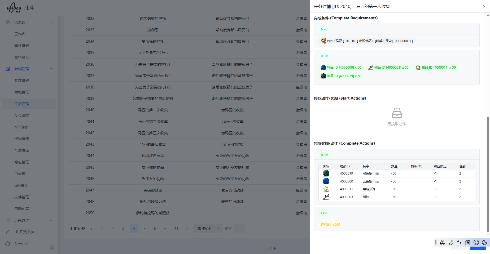
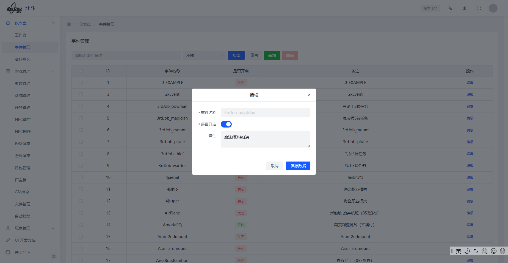
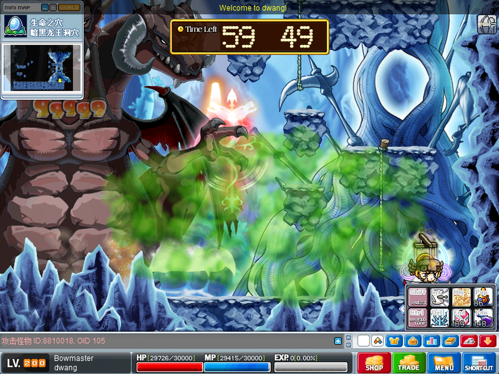

## 20261031
### 修复
1. **嵩山镇 702000000 进图闪退**（弹 -2147467261）：10-24 删地图 obj 后索引断档（`3/obj` 缺 14），客户端按索引连续取到空节点抛 `E_POINTER`。已把 `3/obj` 重排成 0~15 连续，并恢复 `h-top03` → 徐州平原3（`701010600`/`xuzhou00`）传送口。
2. **少林秘室 702060000 进图闪退**：`9600025 武林妖僧` 带 6 段攻击动画（客户端只认 `attack1`-`attack4`），已删 `attack5`/`attack6`。

### 工具
1. `start.cmd`：代码已是最新时**不再跳过客户端同步**。以前版本号一样就直接 `DO_CLIENT=0`，一旦上一轮客户端没同步成功（或本地文件被改回旧版），就永远"版本最新、文件是旧的"，怎么跑都修不回来。
2. `sync-client.ps1`：`client-dist.sha256` 里记的哈希和 `client-dist` 里的实际文件对不上时（改完忘了跑 `make-manifest.ps1`），按**实际文件**为准并给出警告，避免客户端被误判成"已是最新"而跳过更新。


## 20261024
### 新增
1. 新增少林寺相关地图。从徐州平原3进入
2. 新增英语村
3. 更新黄金寺庙的npc


## 20261021
### Server
1. 迁移 059 泰国内容：9 张地图（500000000 / 500010000 / 500010100 / 500020000 / 500020100 / 500020101 / 500020200 / 500020300 / 500020400，新建 `wz\Map.wz\Map\Map5`），配套 Tile `thai`/`thai2`、Obj `thai`/`EnSchoolCN`、Back `thai`、BGM `BgmTH`（ThaiTown/ThaiField）；地图引用的 `connect`/`acc1`/`guide`/`signboard` 节点目标里本来就有，逐条核对过。
2. 新增 NPC 23 个（9250000-9250029 的泰国 NPC + 9310057 / 9310059 / 9310060 / 9330045）和怪物 2 个（9500196 幽灵、9500197 透明幽灵）；任务 4200-4218 共 19 个（QuestInfo / Say / Check / Act 全套；任务链：想变漂亮的芬拉 / 芬拉想去晚会 / 蛇的营养餐 / 害怕蛇的吉特叔叔 / 加入水上市场维护队 / 水上市场维护队的任务）。任务用到的物品（4031xxx、40002xx 等）目标里本来就有。
3. **位置**：地图/NPC/怪物/素材/BGM 的数据走 `wz\`；**任务和字符串走汉化层 `wz-zh-CN\`** —— Quest.wz 四个文件补 19 个任务，String.wz 的 Npc 补 `9310059`、Mob 补 `9500196`/`9500197`（`Map.img` 的 `thai` 和 22 个泰国 NPC 名字汉化层里本来就有，没重复加）。第一次错加到 `wz\Quest.wz` / `wz\String.wz`，已 revert 掉。
4. 追加迁移**泰国金庙 / 巨人洞穴 13 张图**（501000000 金庙、501010000/501010100/501020000/501020100/501020200 猴丛林藤蔓一~五、501030000+501030100-501030105 巨人洞穴 I~V/巨大的密室/室无望），源是北斗 GMS083（059 没有这批图）：新增 Tile `goldTempleTownTH`/`goldTempleFieldTH`/`goldTempleDungeonTH`/`ancientForest`、Obj `goldTempleTH`、Back `goldTempleTH`；新增 NPC 16 个（9250032-9250041、9250047-9250050、9330072、9000021）和怪物 7 个（9420007-9420009、9420011-9420014，**9420014 六手邪神 = BOSS**）；汉化层 String 补 13 个地图名（thai 节点下）+ NPC/Mob 名字（北斗是繁体，已手转简体）。**客户端 img 已转换**：北斗的 img 和 053 同为一种格式、只是混淆 IV 不同（北斗 =「国际服务器(低版本)」IV `4D 23 C7 2B`，053 = `00000000`，userKey 同一个 DEFAULT_KEY）。用 OrzRepacker MCP：北斗 key 打开 → 053 key 新建空 img → copy/paste 全部根节点 → 保存，43 个文件（13 图 + Tile 4 + Obj 1 + Back 1 + NPC 16 + 怪物 7 + BgmTH 5 首）全部转成 053 格式（头 `73f8fad9…`，canvas 都在），并镜像进 `client-dist\data\Data`。5. 任务/商店脚本**没有写**，需要自己补；清单见 `doc\地图迁移\20261021-泰国内容迁移.md` 第六节（9250000/9250001/9250003/9250004/9250005/9250012/9250013/9250014/2012017 要任务脚本，2012012 已有脚本要加 4200-4204，9250007/9250008/9250009 是商店）。服务端 `Map.wz` 有缓存，要重启或 `!reloadmap` 才会加载新地图。
5. 金庙任务线**已迁**（4401-4434 共 33 个，源北斗 v83，繁体用 Win32 `LCMapStringEx` 批量转简体，再手工补 `麽→么`/`於→于`，复扫 0 残留；迁移时过滤 `start`/`end`/`autoStart`/`autoComplete` 字段，保证任务随时可接可交）。配套迁了 **25 个物品**（1002581/1002669/1002670 六手邪神头盔 I/II/III、2022230 番石榴、2044802/2044902 卷轴、4000307-4000312、4000390、4031717-4031726/28、4031742；服务端 xml 从客户端 img 反推生成，客户端 img 从北斗转 053）和 **NPC 9250002**（任务中间人，北斗里没在任何地图召唤）。NPC 脚本仍要自己写。
6. 金庙线回程：501010100（猴丛林藤蔓二）的 `west00` 原数据就是 `tm=500020101 / tn=east00`（北斗自带，迁图时已带过来），但 **500020101 东区外两个版本都没有回程口**（只有 sp×3 + bottom00→500020100）。在 **500020101** 加 portal `east00`（pt=2，x=-529 y=-60，→ 501010100 的 `west00`）；服务端 `wz/Map.wz/Map/Map5/500020101.img.xml` + 客户端 `Data/Map/Map/Map5/500020101.img`（`portal/4`）+ client-dist 已改。
### Client
1. `client-dist\data\Data` 已同步泰国数据（9 张地图 img、Tile/Obj/Back 素材、BgmTH、23 个 NPC、2 个怪物、String 的 Map/Npc/Mob、4 个 Quest img、`MapHelper.img` 的 `mark/Thai`）；client-dist 版本号这次没动，要发布时再走 publish 脚本。
2. img 头字段 offset 0x0C 的真实语义纠正为「根节点数量」（不是数据偏移）：OrzRepacker 保存时写入加载时的旧数量，新加的节点就读不出来。本次 4 个 Quest img 和 String/Map/Npc/Mob 都按实际节点数改好了（Quest 类 +0x100 x 新增数、String/Map 低 16 位 +1、MapHelper 的根数量不变不要动）。
3. 补上之前丢掉的 **8516-8527（12 个任务）** 客户端 img 节点：从 `wz-zh-CN\Quest.wz` 的 XML 生成节点写进 `Data\Quest\{QuestInfo,Check,Act,Say}.img`（用 MCP `create_child` 在副本上建好再整块写回），条目数 QuestInfo 847→859、Check 845→857、Act 846→858、Say 847→859，文案/条件/奖励逐条核对过（8516 财神的委托1 / 屈原 9330015 / 4031326 等）。
4. 金庙任务/物品客户端数据：`Quest\{QuestInfo,Check,Act,Say}.img` 各 +33 个任务（条目到 892/890/891/892）；`Item\{Consume\0202,0204, Etc\0400,0403}.img` +22 个物品、`Character\Cap\01002581,01002669,01002670.img`（北斗转 053）、`Npc\9250002.img`、`String\Item.img` 的 `Etc`/`Con`/`Eqp/Cap` 加名字和说明；全部同步到 `client-dist\data\Data`。

5. 补漏（2026-10-21 夜，实测反馈）：① `Data\String\Map.img` 的 `thai` 节点只加了 059 的 9 张图，北斗那 13 张没加 → 5010* 地图没名字，已补齐（thai 下 22 个）；② `Data\String\Npc.img` 没加金庙 NPC 名字（9250032-9250050、9330072、9250002 纳雷斯船长）已补；③ `Data\String\Mob.img` 补 9420007-9420014 七个名字；④ **`Data\Map\MapHelper.img` 缺 `mark/GoldTempleTH`**（13 张图的 `info/mapMark=GoldTempleTH`，客户端原来只有 `mark/Thai`）——进 5010* 图时取地图标记图失败会闪退，已从北斗转过来补上。以上 4 个文件已同步 `client-dist\data\Data`。


## 20261015
1. 定位并修复「客户端商城顶部分类标签与实际商品错位一格」（点上衣出裤裙、点裤裙出鞋子）：`v53-client\Data\Etc\Category.img` 是 2026-09-21 用 OrzRepacker 从 `汉化\cn-v1-xml\Etc.wz\Category.img.xml`（汉化时把 Name 相对 `Category`/`CategorySub` 整体错位了一格的源文件）整包导出的；053 客户端是「用同一条节点的 `Name` 当标签文字、用该节点的 `Category`+`CategorySub` 拼 SN 前缀选商品」，所以名字错位 = 标签与内容错位（2/4 挂着上衣的名字却装的是 sub=5 的裤裙）。已修 `client-dist\data\Data\Etc\Category.img`（Name 与 Sub 对齐，并把 2/4 由「热销」改为「上衣」）和 `gms-server/gms-handler/wz-zh-CN/Etc.wz/Category.img.xml`（同步 2/4=上衣），并重算 `client-dist.sha256`；客户端要跑 `client-dist\tools\更新客户端.bat` 才会替换 9-21 的旧文件。
2. 新增文档 `doc/商城加载相关说明.md`：
3. 商城上架昭和/豫园 15 张美容会员卡：服务端 `wz-zh-CN/Etc.wz/Commodity.img.xml` 与 `wz/Etc.wz/Commodity.img.xml` 各改写节点 4468~4474、新增节点 5192~5199（共 5200 条），`wz/Item.wz/Cash/0515.img.xml` 补 `05152045`/`05152046`（053 原本缺这两个规格，从 083 服抄）；客户端 `client-dist/data/Data/Etc/Commodity.img` 写入同样 15 条（用 orange-wz 写，写完 5200 条与服务端 zh-CN XML 逐字段一致），`client-dist/data/Data/Item/Cash/0515.img` 从 083 客户端复制 `05152045`/`05152046`（含 icon/iconRaw 图标）；名字与说明两边本来就有，String 未动。
4. 上面 15 张卡的 SN：昭和 8 张用 083 服同款号 `50000170`~`50000177`（053 的 500 段原本正好空到 169，直接接上）；豫园 7 张用 cms48 官方号 `50000025`~`50000031`，这 7 个号在 053 被 7 条 `OnSale=0` 的隐藏记录占着，因此就地改写（被顶掉的道具在别的 SN 上仍然存在，商城无可视变化；注意礼包 9101153/9101156/9101160 的成员 SN 引用了其中 3 个号，这 3 个礼包本身也未上架）。价格按 053 同类卡（普通 2100、高级发型 5700、高级染色 4500、高级整形 5100、护肤 2700），`Period=-1` 不限时，`OnSale=1`。
5. 消耗侧：昭和 8 张已有脚本 `scripts-zh-CN/npc/9120100~9120103.js` 处理，但 5152045/5152046（美瞳）的消费分支在 `selection == 2` 而菜单只挂了 `#L1#`/`#L3#`，要用得各补一行 `#L2#`；豫园 7 张目前没有任何脚本引用，待配 NPC。详见 `doc/商城加载相关说明.md` §6。
6. 「美容美发」整页按地区重排显示顺序（原先 178 条优先级 3~10、同优先级按 ItemId 混排，各城市的卡互相穿插）：从 053 客户端 `CCashShop::LoadData`(GMSv53.exe:0x45388E) 的三段排序（主键 `Priority` 降序 → 次键 `OnSale` 降序 → 末键 `ItemId` 升序）确定「SN 决定进哪个页签、Priority 决定页签内位置」，据此给每个地区一段优先级（昭和 200 / 豫园 190 / 射手村 180 / 婚礼村 170 / 新叶城 160 / 天空之城 150 / 玩具城 140 / 武陵 130 / 废弃都市 120，段内 `Priority = 段 + (在售?2:1)` 让未上架的沉到本地区最后，段内顺序交给 ItemId 天然排成 发型→染色→整形→美瞳→护肤）。地区从中文名识别（含 542000x「美发会员优惠券」7 张也归入各自城市）。只改 SN 前缀 500 的 178 条：服务端两个 `Commodity.img.xml` + 客户端 `client-dist/data/Data/Etc/Commodity.img`（按 **SN** 定位，避免同一 ItemId 多条 SN 且 OnSale 不同时串号），已同步到 `v53-client` 并重算 `client-dist.sha256`。
7. 文档 `doc/商城道具上架说明.md` 改名为 `doc/商城加载相关说明.md`，并补充：§0.2「商品在页签里的顺序（客户端排序规则）」、§6.6「美容美发整页按地区重排」；同时修正 §0.1 里「服务端不能凭空增加 SN」的旧结论（客户端 `SetSaleInfo` 在基础表里找不到该 SN 时会新建一条，见 0x77D4BE）。

## 20261013
1. 修复地图废都北方工地 102040000 缺少进入 102040001入口
2. 修复光明节缺少进入地图NPC入口
3. 新增NpcBeauty的相关管理实现，当前数据只管理射手村 ``org.gms.service.NpcBeautyService``
4. 优化NpcCraft的实现。适配更多种类型NPC的。
5. 新增 NpcBeauty 管理后台实现：`org.gms.controller.NpcBeautyController` + `org.gms.service.NpcBeautyAdminService`，支持 npc_beauty_mapping / npc_beauty_pool / npc_beauty_pool_item / npc_dialog 的增删改查（npc_beauty_cat 只读展示），并新增读取 Character.wz 发型/脸型基础样式的接口 `GET /api/npc-beauty/v1/wzStyles`；前端页面 `gms-ui/src/views/game/npcBeauty`。
6. NpcBeauty 调整：npc_beauty_pool_item 返回值新增样式中文名 (styleName)，由 StringInfoProvider 启动时从 String.wz/Eqp.img/Eqp/{Hair|Face} 加载并缓存 (initBeautyStyleNames / getHairName / getFaceName / getBeautyStyleName)；npc_beauty_pool 与 npc_beauty_pool_item 的增删改统一挪到 NPC 列表页的「美容资源池管理」弹窗 (新增 poolManager.vue + GET /api/npc-beauty/v1/poolItems/{poolId})，详情页只保留展示与绑定/解绑。
7. 新增 Flyway 脚本 `V1.14.2__update_beauty_bms_data.sql`：按 `bms/Script/{face,hair,skin}.s` 生成 35 个美容 NPC 的数据（84 个资源池、655 条样式明细、88 条绑定、87 条中文台词、35 条 npc_function_list）；`npc_beauty_cat` 把 `menu_index` 全表唯一化（cat1~9 → 0~8）并新增 id=10「剪发 (美发会员优惠券)」（对应剧本 `askMembershopAvatar(542000x)` 分支，menu_index=9），这样武陵诺马(2090104) 的「整容普通 + 美瞳普通」等任意分类组合都能共存（npcBeauty.js 用 `menu.getMenuIndex()` 动态拼 `#L<n>#`，不受影响）；皮肤 5 个 NPC 共用已有的 `henesys_skin_pool`(id=11) 并把明细补成 0/1/2/3/4；台词从 BMS 葡语/英语剧本翻译为中文，样式明细只写基础样式ID并逐个校验存在于本客户端 Character.wz。
8. NpcBeauty 后台增强：①「美容资源池管理」的资源池列表改为分页（10 条/页，池内样式明细不分页），点「样式明细」自动把明细卡片滚进可视区；②新增「样式管理」按钮与 `styleManager.vue`，按 男发型/女发型/男脸/女脸 四个 tab 列出 053 wz 全部基础样式，显示每个样式被哪些 `npc_beauty_pool` 引用、引用次数（0 = 没被任何池使用），支持勾选多个样式后批量加入多个资源池；对应新增接口 `GET /api/npc-beauty/v1/styleOverview` 与 `POST /api/npc-beauty/v1/addStylesToPools`（已存在的样式自动跳过，新样式追加到池尾）；资源池列表支持按 HAIR/FACE/SKIN 与池名/分类名筛选，样式管理的「加入池子」弹窗默认把已加入的池勾上并打绿标「已加入」。


## 20261009
1. 修复武陵任务 “击退妖怪禅师”、“韩太守的报答”无法完成问题，需要新增地图、物品、BOSS、Reactor从GMS083获取
2. 新增青苹果乐园地图汉化
3. 新增地图800030000 进入昭和村入口


## 20260929
### bugfix
1. 修复宠物设置自动加药水解析包头问题
2. 修复网吧未收集鼠标问题

### Server
1. 迁移 048 的 17 张网吧/premium 地图：180000001、190000000~190000002、191000000/191000001、192000000/192000001、193000000、195000000/195010000/195020000/195030000、196000000/196010000、197000000/197010000（图块/背景/物件依赖目标里本来就有，地图名字 String 也已有）。
2. 迁移 048 的物品 157 个：装备 20（结婚帽、结婚服、韩国武官套、宫中侍女/医女、枫叶耳环、枫叶披风、结婚戒指、烈焰之刃、竹杖、枫叶大将棋、绿林弓等）、宠物云豹 5000016，以及现金/消耗/其它（豫园会员卡系列、喇叭、特效、宠物食品、御守、个人商店执照、请柬、双倍经验卡等）；新建 41 个 wz 文件、往已有组文件插条目、补 78 条中文名。
3. 未迁（048 只有名字、没有实物数据）：Cash 5200003-5200008、5210006，Con 2022059、2141000、2141001，Etc 4110020，Cap 1002472-1002475、1002494，Coat 1042057，Ring 1112805。
4. 未迁（按规则跳过）：洗点卷轴 2180000-2180003、封印之锁 2200001、双倍爆率频道票 5220002/4110002、大擂台 5220003/5220004/4110003/4110004。
5. 迁移 048 的任务 8516-8527（财神/屈原/管仲/司马迁/张良六组送信任务，去掉活动 start/end 有效期），补 NPC 屈原 9330015，并在 104000000 / 101010101 / 222010201 / 220070201 加上对应 NPC 召唤（foothold 按目标地图几何重映射）。
6. 召唤红鸾宫入口 NPC：9300000 三情法师 → 100000000 射手村、9300001 四善法师 → 200000000 天空之城、9300002 五嗔法师 → 220000000 玩具城（foothold 按目标地图几何重映射）；9300009 六欲法师 早在 700000200 宴客堂。这 4 个 NPC 目前没有脚本，点击暂不会传送。
### Client
1. client-dist 1.1.8：任务 8516-8527 + NPC 9330015 + 4 张地图召唤。
2. client-dist 1.1.9：17 张网吧地图 + 157 个物品的 img 与名字（Data\Map、Data\Item、Data\Character、Data\String\Item.img）。
3. client-dist 1.1.9 里同时带上 100000000 / 200000000 / 220000000 三张城镇地图 img（红鸾宫入口 NPC 的召唤数据）。
4. 修 Quest img 头部字段：OrzRepacker 保存时把 offset 0x0C 的字段算大，客户端一启动就 E_POINTER（-2147467261）；已把 Check/Act/QuestInfo/Say 四个文件该字段改回迁移前的值。
5. client-dist 1.1.10：修"开着 UI 进商城再出来，窗口偏移甚至跑到屏幕外"（装备/技能/物品/小地图等，开着任务助手也会触发）。原因：商城期间客户端把游戏窗口挪到屏幕外，销毁时 `CWnd::Destroy [sub_750C0D]` → 虚表 slot 4 `sub_6DD737` → `CConfig::SetUIWndPos [0x471A38]` 把"屏幕外坐标"写进了窗口位置表，而重建窗口时（如 `CUIMiniMap::Init [0x66507A]`）该值被当**设计坐标**用，于是每进一次商城就多叠一层偏移，最后整片 UI 跑出屏幕；小地图每个对象只建一次窗口，所以不会自愈。插件在写表处丢弃屏幕外坐标（槽位保留上一次正常值），并给小地图建窗加了屏幕外兜底（回客户端默认的 8,8）；另加 `DebugUiLayout` 开关的文件日志 `uilayout_trace.log`（默认关）便于以后排查排版问题。

## 20260928
1. 修复复活节任务
2. 烧烤任务
### Server
1. 迁移东方神州（CN）地图组：新增 37 张地图（红鸾宫/上海/大擂台，Map\Map7 段），配套 Tile/Obj/Back 素材、BGM、怪物 9619999、NPC 9310004-9310007 / 9310013-9310019 / 9310021 / 9330042 / 9900007，并补 String.wz 的 Npc/Mob 名称。
2. 迁移任务 4100-4109（QuestInfo/Say/Check/Act 全套），随后去掉 4107、4108，换成原版兑换任务 8515。
3. 地图 102000000 新增 NPC 9310000（勇士部落飞上海）与旁边的飞机元件。
4. 任务冷却提示改中文：这个任务可在xx时xx分xx秒后重新开始。
### Client
1. client-dist 1.1.6：客户端 Data 同步新增上述地图、素材、任务、NPC、字符串（Data\Map、Data\Quest、Data\Npc、Data\String、Data\Sound\BgmCN 等）。
2. client-dist 1.1.7：插件 Hook.dll 修复商城 / ITC 按账号性别过滤商品的问题（账号性别与角色性别不一致时买不到本性别装备）；config.ini 新增 MouseWheelCursorFix（滚轮不再把光标甩到右下角，默认开）。


## 20260927
### Server
1. 设计怪物系统任务相关逻辑：随机地图，实现随机怪物在指定条件召唤。
2. 实现1周年庆、 2周年庆任务
3. 新增部分CN的道具，为任务做准备
4. 新增 盛大易宝 掉落，作为点卷。 爆率10%。
### Client
1. 新增客户端插件，object可能出现在地图前景导致覆盖地图。例如军营地图
2. 优化部分地图因视角看不到地图最下面控制

## 20260926
1.修复商城商品永久
2.宠物可复活和转移亲密度

## 20260925
1. 修复商城无法购买8开头SN物品（任务道具）
2. 修复重复提示问题
3. 修复寂寞的吉夫任务

## 20260924
1. 修复任务：红桃A的秘密能力、情人节：巧克力篮 导致的游戏闪退。
2. 修复打怪任务提示
3. 修复创建账号性别选择
4. hint改为dropmessage
5. 事件发布更新，从springContextUtils发
6. 修复技能书无法使用问题
7. 屏蔽黄波普、绿波普召唤
8. 部分任务任务道具没有回收问题

## 20260919
1. 更新完成就任务。
2. 打TAG1.0.0


## 20260831
1. 修复完整的圣诞节雪球活动

2. 修复九灵龙蛋任务因版本差异无法兑换黑龙项链使用的卷轴问题
3. 从BMS的掉落文件同步掉落。详情查看：``` origin.DropServiceTest```
```sql
-- 需要修改表结构。当前表结构是单个droperId和itemId是组合键。无法适配同一个DropperId掉落多个相同ItemId的情况，而且这多个掉落概率是不一样的，不知道官方为什么这么设计
-- 需要修改表结构如下：
ALTER TABLE drop_data DROP INDEX dropperid;
-- 2. 删除重复/冗余的索引
ALTER TABLE drop_data DROP INDEX dropperid_2;
ALTER TABLE drop_data DROP INDEX mobid;
-- 3. 新建普通的联合索引 (dropperid, itemid)
CREATE INDEX idx_dropper_item ON drop_data (dropperid, itemid);
```
4. 修复怪物掉落位置没有更新问题


## 20260824
### 任务相关
1. 修复Quest.wz相关的解析缺失。
2. 重构Quest相关的处理
3. 新增任务管理后台显示


### 事件相关
1. 检查053可以开启的的事件
2. 修复部分事件因版本问题无法获取item的问题、开船码头显示问题
3. 组队任务重大BUG！部分Portal可以直接通过，被处理像普通过图一样，代码逻辑错误。当前解决方式也有问题```org.gms.server.maps.GenericPortal.checkEventCantEnter```
4. 新增任务管理器管理。（后续功能，添加奖励和经验配置等）
5. Boss测试，都可以攻略。建议画质调节到最低，打BOSS前重启客户端，否则容易炸



### 其他
1. 修复账号自动创建。默认的生日```2005-05-11```, 在文件：```org.gms.property.DefaultDates```修改
2. 修复丢物品无法触发reactor,如果state不为0的type = 100无法触发任务 ```org.gms.server.maps.MapleMap.activateItemReactors```。
3. 新增```天空组队```女神日记本掉落


## 20260817
### 初步重构记录
详情查看： [重构记录](log/20260817项目重构整理.md)

## 20260810
### 重构
1. 拆分项目，```gms-data-provider``` 、``` gms-ui-admin```项目解耦
2. 打算迁移admin的管理和实际使用拆分


## 20260727
### 修复技能
所有主动技能效果和伤害修复

详情查看： [技能修复](log/skill_log.md)

## 20260721
### 修复商城
1. 修复商城操作相关包头内容
2. 修复商城物品在背包无法正常显示问题
3. 修复商城装备穿戴无法正常显示问题
4. 修复宠物相关的包头
### 修复怪物
1. 修复怪物移动相关包
2. 修复技能给怪物上Debuff完全失效问题
3. 修复怪物释放技能给玩家Debuff失效的问题
### 修复召唤物
1. 修复召唤物相关包、召唤、移动攻击


## 20260713
1. 冷却时间包修复
2. BUFF显示修复
3. GM隐身技能修复
4. quest = 1028 修复 -> nextQuest执行修复
5. 多个角色加载修复
6. 仓库使用修复

## 20260706
1. 修复登录
